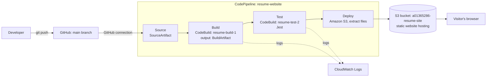

# Resume Site: CI/CD Pipeline on AWS

A static resume website (`index.html`, `style.css`) that is built, tested and deployed automatically by AWS CodePipeline every time code is pushed to the `main` branch of this repository.

- **Repository:** https://github.com/DominicCYT/resume-site
- **Live site:** http://a01365286-resume-site.s3-website-us-west-2.amazonaws.com
- **Region:** us-west-2 (Oregon)
- **Pipeline:** `resume-website`

## 1. Pipeline architecture



| Stage | AWS service | Input artifact | Output artifact | What it does |
|---|---|---|---|---|
| Source | CodePipeline + GitHub connection (`resume-github`) | none | `SourceArtifact` | Detects a push to `main` and saves a snapshot of the repository |
| Build | CodeBuild project `resume-build-1` (`buildspec-build.yml`) | `SourceArtifact` | `BuildArtifact` | Runs `npm run build`, which copies the site files into `dist/` and exports only that folder |
| Test | CodeBuild project `resume-test-2` (`buildspec-test.yml`) | `SourceArtifact` | none | Runs `npm ci` and the Jest tests. A failure stops the pipeline before deploy |
| Deploy | Amazon S3 deploy action | `BuildArtifact` | none | Extracts the built files into the S3 hosting bucket |

Design notes:
- CodePipeline only orchestrates. CodeBuild is the worker that executes the commands for the Build and Test stages.
- Build decides what gets published: `BuildArtifact` contains only `index.html` and `style.css`, so development files (`package.json`, tests, buildspecs) are never uploaded to the public bucket.
- Test decides whether publishing is allowed: it runs checks on the repository files for the same commit. Because the build for this static site is a plain file copy, the tested files and the built files are identical.
- Each CodeBuild project has its own IAM service role, and the pipeline has a separate service role.

## 2. Repository contents

| File | Purpose |
|---|---|
| `index.html`, `style.css` | The resume website |
| `package.json`, `package-lock.json` | Defines the `build` and `test` scripts and the Jest dependency |
| `tests/site.test.js` | Jest tests: title and language, a single h1, all sections present, nav links resolve, stylesheet exists |
| `buildspec-build.yml` | Build commands and output artifact settings (exports `dist/`) |
| `buildspec-test.yml` | Test commands (`npm ci`, then `npm test`) |
| `.gitignore` | Excludes `node_modules/`, `dist/`, logs, `.env` and similar |
| `README.md` | This documentation |

## 3. Setup steps (AWS console, us-west-2)

### 3.1 S3 bucket for hosting
1. S3 > Create bucket. Name: `a01365286-resume-site`, region us-west-2.
2. Untick "Block all public access" and acknowledge the warning. Create the bucket.
3. Properties > Static website hosting > Enable. Index document: `index.html`.
4. Permissions > Bucket policy: allow public read of objects.
   ```json
   {
     "Version": "2012-10-17",
     "Statement": [{
       "Effect": "Allow",
       "Principal": "*",
       "Action": "s3:GetObject",
       "Resource": "arn:aws:s3:::a01365286-resume-site/*"
     }]
   }
   ```

### 3.2 GitHub connection
Developer Tools > Settings > Connections > Create connection. Choose GitHub, name it `resume-github`, click Connect to GitHub, and install the AWS Connector for GitHub app on the `resume-site` repository. Wait until the status shows Available. The connection must be in the same region as the pipeline. Afterwards the app appears in GitHub under Settings > Applications > Installed GitHub Apps. Without the installed app, pushes do not start the pipeline.

### 3.3 CodeBuild projects
Create two projects (CodeBuild > Create project, or from the pipeline wizard), each with its own new service role:

| Setting | `resume-build-1` | `resume-test-2` |
|---|---|---|
| Source | GitHub, repo `DominicCYT/resume-site`, branch `main` | same |
| Environment | Managed image, Amazon Linux, Standard runtime, latest image | same |
| Service role | New service role | New service role |
| Buildspec | `buildspec-build.yml` | `buildspec-test.yml` |
| Logs | CloudWatch logs enabled | CloudWatch logs enabled |

When a project runs inside the pipeline, the pipeline's `SourceArtifact` is the input. Both projects work from the same commit.

### 3.4 Pipeline `resume-website`
1. CodePipeline > Create pipeline > Build custom pipeline. Name `resume-website`, new service role.
2. **Source:** GitHub (via GitHub App), connection `resume-github`, repository `DominicCYT/resume-site`, branch `main`, start the pipeline on source code change. Output artifact `SourceArtifact`.
3. **Build:** AWS CodeBuild, project `resume-build-1`, input `SourceArtifact`, output `BuildArtifact`.
4. **Test:** AWS CodeBuild, project `resume-test-2`, input `SourceArtifact`, no output artifact.
5. **Deploy:** Amazon S3, bucket `a01365286-resume-site`, input `BuildArtifact`, tick "Extract file before deploy".
6. Create the pipeline. It runs once automatically.

### 3.5 Pipeline service role permissions
The pipeline's service role (see the pipeline's Settings page for its name) needs these permissions beyond the defaults the wizard creates. They are added as an inline policy on that role:

| Permission | Why it is needed |
|---|---|
| `codeconnections:UseConnection` and `codestar-connections:UseConnection` on the GitHub connection | Lets the Source stage read the repository |
| `codebuild:StartBuild`, `codebuild:BatchGetBuilds`, `codebuild:StopBuild` | Lets the Build and Test stages run the CodeBuild projects |
| `s3:PutObject`, `s3:PutObjectAcl`, `s3:GetObject`, `s3:DeleteObject`, `s3:ListBucket`, `s3:GetBucketLocation` on `a01365286-resume-site` | Lets the Deploy stage write the site files to the hosting bucket |
| `s3:GetObject`, `s3:PutObject`, `s3:GetObjectVersion`, `s3:GetBucketVersioning`, `s3:GetBucketAcl`, `s3:GetBucketLocation` on `codepipeline-us-west-2-*` | Lets stages pass artifacts through the pipeline's artifact bucket |

The connection permission must match the connection in use, so update it if the connection is recreated.

### 3.6 Local development
```
npm ci
npm test        # runs Jest against the files in the repo root
npm run build   # creates dist/
```

## 4. How to use and maintain

- **Update the resume:** edit `index.html` or `style.css`, then `git commit` and `git push` to `main`. The pipeline starts within seconds and takes a few minutes.
- **Add tests:** put new `*.test.js` files in `tests/`.
- **Change build or test commands:** edit the `buildspec-*.yml` files in the repo, not the CodeBuild project.
- **View logs:** CodePipeline > the stage > Details opens the CodeBuild run. Logs are also in CloudWatch Logs under `/aws/codebuild/<project-name>`.
- **Re-run without a code change:** CodePipeline > Release change.
- **Update Node or the build image:** change `nodejs:` in the buildspecs or the image in the CodeBuild project environment.
- **Cost:** S3, CodeBuild and CodePipeline usage for one small site is minimal. Delete the pipeline, CodeBuild projects, IAM roles, connection and bucket when they are no longer needed.

## 5. Troubleshooting

| Symptom | Likely cause and fix |
|---|---|
| Pushes to GitHub do not start the pipeline | The AWS Connector for GitHub app is not installed on the GitHub account or lacks access to the repository. Install it through a new connection, then confirm it appears under GitHub > Settings > Applications > Installed GitHub Apps. Also check the Source action's trigger filters |
| Source stage: "Unable to use Connection ... role does not have sufficient permissions" | The pipeline role lacks `codeconnections:UseConnection` for the connection's ARN. Add or update the inline policy (section 3.5) |
| Build stage: `codebuild:StartBuild` not authorized | The pipeline role lacks CodeBuild permissions. Add them (section 3.5) |
| CodeBuild: `ACCESS_DENIED` creating CloudWatch log streams | The project's service role only allows logs for a different project name. Give each project its own new service role, or widen the log resource to `/aws/codebuild/resume-*` |
| `buildspec ... no such file or directory` | The file is not at the repository root, or the project's Buildspec name does not match the real file name exactly |
| Runtime version not supported | The image does not provide that Node version. Change `nodejs: 20` in both buildspecs to a version listed in the build log |
| `npm ci` fails | `package-lock.json` is missing from the repository or out of date. Run `npm install` locally and commit it |
| Test stage fails | Run `npm test` locally and fix the page or the test. Deploy is skipped by design |
| Deploy succeeds but the site shows old content | Hard refresh the browser (Ctrl+Shift+R) |
| 403 Forbidden on the site | Bucket policy missing, or Block Public Access is still on |
| CloudWatch log group is empty | The build failed before commands ran, or ran before logging was enabled. Re-run and check the build's Phase details |

## 6. Feature list

| Requirement | Status |
|---|---|
| Resume website with professional styling | Completed |
| GitHub repository with code and `.gitignore` | Completed |
| CodePipeline monitors the repository for changes | Completed |
| Build stage (CodeBuild) | Completed |
| Test stage (CodeBuild running Jest) | Completed |
| Deploy stage (S3 static website) | Completed |
| Automated tests integrated in the pipeline | Completed |
| Documentation with diagram, setup, maintenance, troubleshooting | Completed |
| CloudWatch Logs for build output | Completed (automatic with CodeBuild) |

