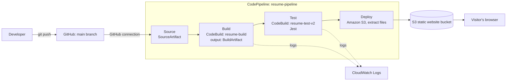

# Resume Site: CI/CD Pipeline on AWS

A static resume website (`index.html`, `style.css`) that is built, tested and deployed automatically by AWS CodePipeline every time code is pushed to the `main` branch of this repository.

- **Repository:** https://github.com/DominicCYT/resume-site
- **Live site:** `http://<YOUR-BUCKET-NAME>.s3-website-us-west-2.amazonaws.com` (replace with your S3 website endpoint)
- **Region:** us-west-2 (Oregon)

## 1. Pipeline architecture



| Stage | AWS service | Input artifact | Output artifact | What it does |
|---|---|---|---|---|
| Source | CodePipeline + GitHub connection | none | `SourceArtifact` | Detects a push to `main` and saves a snapshot of the repo |
| Build | CodeBuild (`buildspec-build.yml`) | `SourceArtifact` | `BuildArtifact` | Runs `npm run build`, which copies the site files into `dist/` |
| Test | CodeBuild (`buildspec-test.yml`) | `SourceArtifact`, `BuildArtifact` | none | Runs `npm ci` and Jest tests against the built files. A failure stops the pipeline before deploy |
| Deploy | Amazon S3 deploy action | `BuildArtifact` | none | Extracts the built files into the S3 website bucket |

Design notes:
- The Test stage takes `SourceArtifact` first because it holds `package.json`, the tests and the buildspec. `BuildArtifact` is second, and the tests read the built `index.html` and `style.css` from it (via the `SITE_DIR` variable), so the tested files are the ones that get deployed.
- Each CodeBuild project's own source setting is ignored when it runs in a pipeline. CodePipeline provides the artifacts.

## 2. Repository contents

| File | Purpose |
|---|---|
| `index.html`, `style.css` | The resume website |
| `package.json`, `package-lock.json` | Defines the `build` and `test` scripts and the Jest dependency |
| `tests/site.test.js` | Jest tests: title, single h1, all sections present, nav links resolve, stylesheet exists |
| `buildspec-build.yml` | Build commands and output artifact settings |
| `buildspec-test.yml` | Test commands |
| `.gitignore` | Excludes `node_modules/`, `dist/`, logs, `.env` and similar |
| `README.md` | This documentation |

## 3. Setup steps (AWS console, us-west-2)

### 3.1 S3 bucket for hosting
1. S3 > Create bucket. Use a globally unique name; region us-west-2.
2. Uncheck "Block all public access" and acknowledge the warning. Create the bucket.
3. Properties > Static website hosting > Enable. Index document: `index.html`.
4. Permissions > Bucket policy: allow public read of objects:
   ```json
   {
     "Version": "2012-10-17",
     "Statement": [{
       "Effect": "Allow",
       "Principal": "*",
       "Action": "s3:GetObject",
       "Resource": "arn:aws:s3:::YOUR-BUCKET-NAME/*"
     }]
   }
   ```

### 3.2 GitHub connection
Developer Tools > Settings > Connections. Use an existing connection with status `Available` (this project uses `lab8`), or create a GitHub connection and complete the authorization in the browser. The connection must be in the same region as the pipeline. In GitHub, make sure the AWS Connector app has access to this repository.

### 3.3 Pipeline and CodeBuild projects
1. CodePipeline > Create pipeline > Build custom pipeline. Name: `resume-pipeline`. New service role, default artifact store.
2. **Source:** GitHub (via GitHub App), your connection, repo `DominicCYT/resume-site`, branch `main`. Keep "Start the pipeline on source code change" enabled. Output artifact: `SourceArtifact`.
3. **Build:** AWS CodeBuild. Click Create project from the wizard:
   - Name `resume-build`, managed image, Amazon Linux, Standard runtime, latest image, new service role.
   - Buildspec: `buildspec-build.yml`.
   - Input `SourceArtifact`, output `BuildArtifact`.
4. **Test:** AWS CodeBuild (Test category). Create project `resume-test-v2` with buildspec `buildspec-test.yml`. Input artifacts: `SourceArtifact` first, then `BuildArtifact`. No output artifact.
5. **Deploy:** Amazon S3, the hosting bucket, input `BuildArtifact`, tick "Extract file before deploy".
6. Create the pipeline. It runs once automatically.

### 3.4 Local development
```
npm ci
npm test        # runs Jest against the files in the repo root
npm run build   # creates dist/
```

## 4. How to use and maintain

- **Update the resume:** edit `index.html` or `style.css`, then `git commit` and `git push` to `main`. The pipeline starts within seconds and takes a few minutes.
- **Add tests:** put new `*.test.js` files in `tests/`.
- **Change build or test commands:** edit the `buildspec-*.yml` files, not the CodeBuild project.
- **View logs:** CodePipeline > the stage > Details opens the CodeBuild run. Build logs are also in CloudWatch Logs under `/aws/codebuild/<project-name>`.
- **Re-run without a code change:** CodePipeline > Release change.
- **Update Node or the build image:** change `nodejs:` in the buildspecs or the image in the CodeBuild project environment.
- **Cost:** S3, CodeBuild and CodePipeline usage for a single small site is minimal. Delete the pipeline, CodeBuild projects and bucket when the project is no longer needed.

## 5. Troubleshooting

| Symptom | Likely cause and fix |
|---|---|
| Source stage fails | GitHub connection is `Pending` or lacks access to the repo. Authorize the connection and grant the AWS Connector app access to the repository |
| `buildspec ... no such file or directory` | The action's input artifact is wrong, or the file is not at the repo root. The Test action must list `SourceArtifact` first. Confirm the file name matches the project's buildspec setting |
| Runtime version not supported | The image does not provide that Node version. Change `nodejs: 20` in both buildspecs to a version listed in the build log |
| `npm ci` fails | `package-lock.json` is missing from the repo or out of date. Run `npm install` locally and commit it |
| Test stage fails | Run `npm test` locally and fix the page or the test. Deploy is skipped by design |
| Deploy succeeds but site shows old content | Hard refresh the browser (Ctrl+Shift+R) |
| 403 Forbidden on the site | Bucket policy missing, or Block Public Access is still on |
| CloudWatch log group is empty | The build failed before commands ran, or has not run since logging was enabled. Re-run and check the build's Phase details |

## 6. Feature list

| Requirement | Status |
|---|---|
| Resume website with professional styling | Completed |
| GitHub repository with code and `.gitignore` | Completed |
| CodePipeline monitors the repository for changes | Completed |
| Build stage (CodeBuild) | Completed |
| Test stage (CodeBuild running Jest) | Completed |
| Deploy stage (S3 static website) | Completed |
| Automated tests integrated in the pipeline | Completed |
| Documentation with diagram, setup, maintenance, troubleshooting | Completed |
| CloudWatch Logs for build output | Completed (automatic with CodeBuild) |
| CloudWatch alarms and notifications (optional) | Not completed |
| CloudFront / HTTPS / custom domain | Not completed |
| Manual approval stage or staging environment | Not completed |
| Infrastructure as code (CloudFormation) | Not completed |
