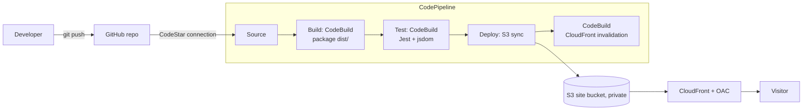

# Resume Site – CI/CD on AWS

Static resume (`index.html`, `style.css`) deployed by AWS CodePipeline on every push to `main`.

## Architecture


| Stage | Service | What it does |
|---|---|---|
| Source | GitHub via CodeStar Connection | Triggers on push to `main` |
| Build | CodeBuild (`buildspec-build.yml`) | Copies site files into `dist/` and outputs them as the artifact |
| Test | CodeBuild (`buildspec-test.yml`) | `npm ci` then `jest`; a failure stops the pipeline before deploy |
| Deploy | S3 deploy action + CodeBuild | Extracts artifact into the site bucket, then invalidates CloudFront |

Everything is defined in `infra/pipeline.yaml`. Note: CodeCommit is closed to new customers, so GitHub is the source.

## Setup
1. Replace the placeholder resume content in `index.html` and `tests/site.test.js`.
2. Create a GitHub repo, then push: `git init && git add . && git commit -m "Initial site" && git branch -M main && git remote add origin <url> && git push -u origin main`
3. In the AWS console (**us-west-2**): Developer Tools > Settings > Connections > create a GitHub connection and complete the authorization. Copy its ARN.
4. Deploy the stack:
   ```
   aws cloudformation deploy --region us-west-2 --stack-name resume-site \
     --template-file infra/pipeline.yaml --capabilities CAPABILITY_IAM \
     --parameter-overrides GitHubOwner=<you> GitHubRepo=<repo> ConnectionArn=<arn>
   ```
5. Open the `SiteUrl` stack output.

## Local development
```
npm ci
npm test
npm run build   # outputs dist/
```

## Maintenance
- Edit content, commit, push. The pipeline does the rest (about 2–3 minutes).
- Add tests in `tests/`. Keep `buildspec-*.yml` filenames in sync with the template.
- Pipeline status and CodeBuild logs are visible in the AWS console (CloudWatch Logs).
- Artifacts expire after 30 days (S3 lifecycle rule).
- Costs: pennies per month for S3, CloudFront and CodeBuild at this traffic; CodePipeline V1 is free for one pipeline.
- Tear down: empty both buckets, then `aws cloudformation delete-stack --stack-name resume-site`.

## Troubleshooting
| Symptom | Likely cause / fix |
|---|---|
| Source stage fails | CodeStar connection is still `Pending`; finish authorizing it. |
| Test stage fails | Run `npm test` locally; fix the page or the test. Deploy is skipped by design. |
| Site shows old content | Invalidate action failed or browser cache; check the Deploy stage logs. |
| 403 AccessDenied on site | Bucket policy or OAC missing; redeploy the stack. |
| Build cannot find `dist` | Build commands must create `dist/`; see `package.json` `build` script. |

## Feature checklist
| Requirement | Status |
|---|---|
| Resume website | Done |
| GitHub repo + `.gitignore` | Done |
| CodePipeline: Source / Build / Test / Deploy | Done |
| Automated tests (Jest) in pipeline | Done |
| CloudWatch alarms and notifications (optional) | Not done (skipped; CodeBuild logs still go to CloudWatch Logs) |
| Documentation with diagram | Done |
| Custom domain / HTTPS certificate | Not done (uses `*.cloudfront.net`) |
| Manual approval gate, staging environment | Not done |
| Video recording | Yours to record, see below |

## Video outline (about 5–7 min)
1. **Walkthrough (2 min):** show the diagram, `pipeline.yaml`, buildspecs, the live pipeline in the console.
2. **Feature list (1 min):** read the checklist above, completed vs. not completed.
3. **Demo (2–3 min):** change a line in `index.html` (e.g. your job title), commit and push, watch Source → Build → Test → Deploy go green, refresh the site. Optionally break a test first to show the Test stage blocking deploy.
